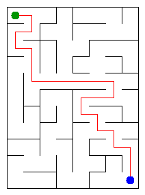

# Assignment 3. Maze Escape

Student ID: **250117**  
Name: **Amir Romanov**  
Group: **SE-2519**  
Maze size: **11 x 8** (88 cells, 157 inner walls)

Java 17 or newer. The implementation uses only the Java standard library and its own DSU and graph algorithms. The original `Main`, `Input`, `Graphs`, `Render`, `Generator`, `Bench` and generator/checking tools are unchanged.

## Run

Run commands from the project folder (the folder containing `src` and this README):

```sh
javac --release 17 -d out src/*.java
java -cp out Main
```

Open [the interactive maze](output/maze.html) in a browser. Use arrow keys or WASD to walk; the checkboxes show the solution, cell numbers, costs, zones and slides. `Main` reads `data/walls.txt` and `data/slides.txt`, prints its results without asking for input, and recreates both maze pictures.

The personal input files were generated with the unchanged tool:

```sh
java tools/MakeVariant.java 250117 data
```

## Program output

```text
Broken: 87
Kept: 70
Last broken wall: 123
MST cost: 29455
Heaviest broken wall: 830
Path length: 23
DFS visited: 53
Dead ends: 23
Zones: 10
Largest zone: 17
Is DAG: 0
Flow stages: 6
Fastest route cost: 8
```



## Questions

### Mission 0. What do find and union do, and what makes them fast?

`find(x)` returns the root representing the set containing `x`; `union(a, b)` joins two different sets and returns whether a merge happened. Union by size places the smaller tree under the larger root, while the iterative `find` compresses the whole visited path to its root, giving an amortized O(alpha(n)) cost per operation. `count()` stores the current number of sets, so it takes O(1).

### Mission 1. Why are Broken = R*C - 1 and Kept = (R-1)*(C-1)?

There are initially R*C components, and every successful union reduces their number by one; since the full rectangular grid is connected, exactly R*C - 1 walls are broken. A grid has R*(C-1) + C*(R-1) inner walls, so subtracting the broken walls leaves (R-1)*(C-1). Here this gives 87 broken walls and 70 kept walls.

### Mission 2. What are the MST costs, and why are they equal?

Kruskal and Prim both return **29455** for the personal maze; the heaviest edge in the minimum spanning tree costs **830**. Kruskal adds the cheapest edge joining different components, while Prim adds the cheapest edge crossing from its current tree to an unvisited cell; both choices are safe by the cut property. All wall costs are distinct, so the minimum spanning tree is unique and both algorithms have the same total cost.

### Mission 3. Why is there exactly one path? How is stack overflow avoided?

The broken walls connect every cell without making a cycle, so they form a tree; two different simple paths between the same cells would create a cycle. The DFS uses arrays on the heap as an explicit stack, with each frame remembering its next direction in the order up, right, down, left, instead of using recursive Java calls. It counts cells when they are first marked and stops as soon as the exit is marked: here 53 cells are visited and the resulting path has 23 moves.

### Mission 4. Why reverse the graph? Why does Zones = n mean no cycle?

The first DFS records finishing order in the original graph; taking vertices in reverse finishing order selects a source component among the components that remain. On the reversed graph, the second DFS can reach every vertex of that component without escaping into another unassigned component, so each pass collects exactly one zone and the resulting zone numbers are topological. Because the input forbids self-loops, a directed cycle must contain at least two vertices and places them in the same zone; therefore the graph is acyclic exactly when every zone is a singleton.

### Mission 5. Why is zone-number order sufficient, and what does the pass cost?

Every edge between zones goes from a smaller number to a larger number, so all incoming results are final when a zone is processed; one forward pass can relax both minimum route cost and maximum chain length. Parallel slides between the same two zones are merged using their minimum time, and movement within a zone is free. Building this condensed graph takes O(m+k) time and space with array-based lists and markers, and the dynamic programming pass takes O(k+q) time, where k is the number of zones and q the number of distinct edges between them; no priority queue is used.

## AI use

**OpenAI Codex (ChatGPT)** generated the algorithm implementations, additional tests and this report, and executed input generation, verification and timing. This is a version made with substantial AI assistance; it does not claim independent authorship, review or modification by the student. Before submission, review and adapt the code and explanations to meet the course rules, and keep this disclosure accurate.

Git commits made during this work identify `Codex (AI assistant)` as the author. No external books, websites, graph libraries or DSU libraries were used; the supplied starter project and assignment were the source of the requirements.

## Verification

```sh
java tools/Check.java
javac --release 17 -Xlint:all -d out src/*.java
java -Xss256k -cp out DisjointSetTest
java -Xmx768m -Xss256k -cp out AlgorithmTest --stress
```

- All 13 output lines match the expected values for `tiny`, `small` and `dag`.
- The sources compile for Java 17 without compiler warnings.
- DSU checks include self-unions, an empty DSU, a singleton and a million-cell chain.
- `AlgorithmTest` performs 17,464 small-instance assertions, including 80 random grids and 400 random slide graphs with a fixed seed of 250117. The independent oracles use BFS for connectivity, exhaustive enumeration for tiny spanning trees, recursive DFS only on tiny test graphs, transitive closure for SCC membership, exhaustive DAG paths for flow stages, and Floyd-Warshall for zone route costs.
- Edge cases include one cell, thin mazes, parallel slides, disconnected slide graphs, one-zone graphs, a longest chain outside the start's reachable region, and totals greater than 32-bit integers.
- Stress checks pass for a 1000 x 1000 snake maze, a million-vertex directed cycle, and a million-vertex directed chain. The Java call stack is limited to 256 KiB for this run.

The recursive methods in the test oracle are used only on graphs of at most nine vertices. All DFS traversals in the mission implementation are iterative.

## Timing and complexity (Mission 7)

Measured with the unchanged `Bench` class on 27 October 2026, using Temurin OpenJDK 25.0.4.1 on Windows and an AMD Ryzen 5 6600H. The source code was also compiled with `--release 17`; the installed JVM used for execution and timing was Java 25.

```sh
java -cp out Bench
```

Milliseconds, five runs per maze. Values and averages are copied as rounded by `Bench` (each is rounded independently).

| Maze | Kruskal: five runs, ms | Kruskal average, ms | Prim: five runs, ms | Prim average, ms |
|---|---|---:|---|---:|
| 100 x 100 | 47, 20, 18, 39, 36 | 32 | 37, 35, 31, 9, 10 | 24 |
| 300 x 300 | 262, 397, 413, 136, 176 | 277 | 215, 184, 227, 106, 130 | 173 |
| 1000 x 1000 | 2172, 2111, 2031, 2047, 1932 | 2059 | 2015, 2031, 1843, 1984, 1974 | 1969 |

Increasing the side length increases the number of cells quadratically, so the time grows substantially as both algorithms handle many more edges. On a rectangular grid m is approximately 2n, giving both implementations an O(n log n) upper bound; Prim was faster in these measurements, with a small difference at 1000 x 1000. Five runs without explicit JVM warm-up include compilation and garbage-collection effects, so the measured ratios need not follow the asymptotic formula exactly.

The original timing output is in [output/bench.txt](output/bench.txt).

### Complexity

Here n is the number of cells, m is the number of input walls or slides, b is the number of broken walls, k is the number of zones and q is the number of distinct directed edges between zones. Space means auxiliary storage unless stated otherwise.

| Algorithm | Time | Space | Assumptions |
|---|---|---|---|
| DSU construction | O(n) | O(n) retained storage | Parent and size arrays |
| DSU find, union, connected | O(alpha(n)) amortized | O(1) per operation | Union by size and iterative path compression; DSU storage is O(n) |
| DSU count | O(1) | O(1) | Maintained component counter |
| Input-order maze construction | O(n + m alpha(n)) | O(n) | Connected rectangular grid; returns n-1 broken walls |
| Kruskal | O(n + m log m) | O(n + m) | Sorts wall indexes, then uses the DSU |
| Prim | O(n + m log n) | O(n + m) | Simple connected grid; standard priority queue can retain obsolete entries |
| Escape DFS | O(n + b) | O(n + b) | Grid degree is at most four; b = n-1 for a maze tree |
| Kosaraju | O(n + m) | O(n + m) | Two iterative DFS passes and forward/reverse adjacency lists |
| Build zone graph and compute routes | O(m + k) | O(m + k) | Given topological zone labels; array markers merge parallel edges |
| DP pass on the built zone graph | O(k + q) | O(k) extra | In addition to the stored graph; no priority queue |

The verification logs are in [output/checks.txt](output/checks.txt), [output/dsu-checks.txt](output/dsu-checks.txt) and [output/algorithm-checks.txt](output/algorithm-checks.txt). A saved personal run is in [output/program.txt](output/program.txt).

## Git and submission

Public repository: [AmirBro0/maze-escape](https://github.com/AmirBro0/maze-escape).

The local repository is on `main`, with an initial starter commit and separate commits for the missions. These are actual commits made during this session, not a reconstruction of earlier student work. Inspect them with `git log --oneline`.

- [x] Source code, personal data and maze picture are included.
- [x] The program compiles and the supplied examples pass.
- [x] The output, answers and accurate AI-use note are recorded.
- [ ] The student has reviewed and adapted the code and explanations.
- [x] The repository has been published as a public GitHub repository with its commit history.
- [ ] The public repository link has been submitted in Moodle.

Student review and submission of the link in Moodle still require the student's action; they have not been marked as completed by the assistant. The setup and assignment remain available in `START_HERE.md` and `docs/Assignment3.pdf`.
